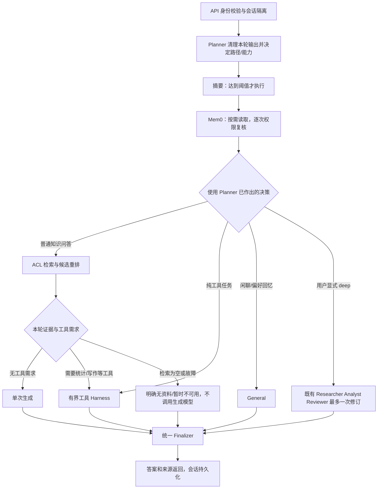

# 主流程收口与秋招讲解

> 2026-09-28。本篇作为当前请求主流程的阅读入口。复用既有 LangGraph、RAG 和工具 Harness；本轮没有新增服务、框架或 Agent 节点。现有服务未重启，代码需正常重启后生效。

## 1. 一条主线，四种任务



这里的分支不是新增的 Agent 调度层。Planner 只做一次决策，后面的条件边读取该结果；摘要和记忆节点不能重新选业务分支。

| 请求 | 最短业务路径 | 不需要的工作 |
|---|---|---|
| `计算 12/3` | Planner → 工具 → 最终答案 | 无历史指代时不读取 Mem0，不检索知识库 |
| `实验室组会多久一次` | Planner → 可选记忆 → 检索 → 普通生成 | 不进入工具循环，不自动进入 deep |
| `根据实验记录计算平均延迟` | Planner → 检索 → 有界工具 → 带来源答案 | 不重复运行普通生成，不互相委派两个 Agent |
| 用户主动选 deep | 保留既有固定研究流程 | 不新增 Supervisor 或动态 fan-out |

长会话仍可能触发摘要。跳过 Mem0 不等于完全不使用会话历史，也不代表整个请求一定只有一次模型调用。

## 2. 本轮修复了什么

### 2.1 路由提前，避免简单工具任务读取长期记忆

旧顺序为“摘要 → 记忆 → Planner”，记忆节点不知道用户实际需要哪个分支。现在改为“Planner → 摘要 → 记忆 → 对应业务分支”，保持原节点集合不变。

对于明确的 calculator、datetime、unit_conversion 任务，如果没有“之前、上次、刚才、偏好”等历史引用，记忆节点直接返回空值。问候语使用 Planner 的准确判断，避免原来按 `你好` 前缀跳过“你好，我之前研究什么？”这类真实回忆问题。

边界：其他统计/写作等场景仍保留记忆路径；这轮没有宣称所有操作任务都可以忽略历史。少做一次 Mem0 search 是可测试的调用次数变化，端到端延迟改善尚未做真实压测。

### 2.2 本轮输出必须覆盖，持久状态不要串轮

LangGraph checkpoint 保存前一轮字段。节点返回 `{}` 表示“不更新”，不是“清空”。因此旧代码在 Mem0 未命中、关闭或异常时，可能继续保留上轮记忆文本。

现在 Mem0 的关闭、跳过、未命中、权限过滤为空、超时和异常路径都显式写 `mem0_memories=""`；成功时写入本轮复核的记忆。

Planner 集中重置本轮输出，包括检索正文、来源、版本说明、质量判定、重写历史、使用的 Agent、工具报告和生成指标。进入普通模式还清空上轮 deep 的证据包、分析报告、审查报告和研究 trace，避免普通答复携带旧研究产物。

保留跨轮应保留的信息：用户会话消息、历史摘要、用户身份、会话/项目标识。deep → deep 的既有证据复用规则保留，不在这轮重新实现。

### 2.3 可选上下文失败不能直接终止任务

摘要和 Mem0 search 的异步等待各设 10 秒上限，摘要调用关闭 SDK 自动重试：

- 摘要失败、超时或输出为空：保留原消息与已有摘要，不先删除历史再补救。
- Mem0 失败或超时：清空本轮记忆，继续既定业务路径。
- 记录异常类别，不把内部错误内容作为检索证据或最终答案。

这是异步等待的边界，不是强制结束同步线程的保证；同步初始化仍有自己的耗时。摘要失败后保留完整历史，后续模型/工具的上下文预算仍可能要求用户缩小任务，不能说故障后必然完成。

### 2.4 检索故障与没有资料是两种结果

旧的普通 RAG 在检索异常后仍可能进入生成模型，并把异常字符串放入上下文。现在：

| 结果 | 用户看到 | 生成调用 |
|---|---|---:|
| 查不到资料 | 未找到相关信息，请补充资料/调整查询 | 0 |
| 后端检索失败 | 资料检索暂时不可用，请稍后重试 | 0 |
| 有资料的普通知识任务 | 依据资料生成答案 | 1 |
| 有资料且需工具 | 共享 Harness 处理后返回答案 | 受原模型/工具预算约束 |

检索错误报告保留 `retrieval_decision=error` 和异常类型指标，返回内容不包含内部连接串。组合任务已由共享 Harness 对缺少有效证据进行停止，继续沿用该行为。普通生成自身失败也返回简短错误，不直接暴露底层异常。

## 3. 代码怎么读：只跟主链

1. [ChatService](../../src/api/services/chat_service.py)：构造身份与会话上下文、普通/流式入口、来源卡片和响应后保存。
2. [Planner](../../src/agent/agents/planner.py)：本轮状态清理、唯一业务路由决策。
3. [Graph](../../src/agent/graph.py)：节点顺序、可选上下文、统一 Finalizer。
4. [Knowledge](../../src/agent/agents/knowledge.py)：检索状态、普通生成或检索后工具。
5. [Operation](../../src/agent/agents/operation.py) 与 [Harness](../../src/agent/harness/runtime.py)：按需工具、预算、执行事件和证据边界。

需要解释 Redis 时再读 [Redis 实际用途](13-Redis实际用途与优化优先级.md)，需要解释数据入库时再读 [分块详解](05-文档分块与入库链路详解.md)。不必在面试开场从所有基础设施和历史优化讲起。

## 4. 验证与演示

新增 [主流程测试](../../tests/test_main_flow.py) 用真实编译图、MemorySaver 和模拟外部边界验证：

- 算术、时间、单位换算和问候不读取 Mem0。
- 带问候前缀的真实记忆问题仍执行一次查询。
- 关闭/未命中/无权限/失败/超时都不沿用旧记忆。
- 摘要失败不丢消息，成功时只移除已摘要部分。
- 检索故障跳过生成，不把内部异常送入答案。
- 两轮请求 Planner 各执行一次；知识问答之后的纯计算不带上轮来源或研究产物。
- 可选摘要失败后，真实主图仍可到达工具分支和统一终态。

```bash
conda run -n agent-demo python -m pytest tests/test_main_flow.py -q
conda run -n agent-demo python -m pytest -q
```

本次验证：新增主流程测试 **18 项通过**；全量 **553 passed、5 skipped**，5 个跳过项为未显式开启的 MySQL 集成测试。

这些测试证明分支、次数和故障契约，不是百炼真实回答质量或 P95 的测量。本轮不运行付费评测，不把模拟模型输出当真人验收。

## 5. 一分钟面试回答

> 我的项目先由一个 Planner 确定业务路径和工具能力，再按需准备上下文。普通问题经过权限检索后单次生成；需要计算的知识问题，在取到授权证据后复用同一个有界工具 Harness；复杂研究必须由用户主动选择。
>
> 我重点处理了工程主线的几个小问题：简单计算不必先读长期记忆；checkpoint 里的旧来源和记忆要显式清理；可选摘要失败不能先丢历史；检索后端故障不能再让模型生成无依据的回答。我用真实主图回归测试验证分支和调用次数，再用独立真实任务评测模型的取数和答案质量。

当前不扩大到限流器重构、分布式任务平台或多套观测系统。限流已定位的待改进项仍保留在 Redis 核对文档，不把它们误写成此次已完成。

## 6. 如何突出 Agent 和 Harness：用“决策—约束—证据”讲

不要把面试重点放在“有几个 Agent、接了多少工具”。当前最清晰的技术主线是三层：

```text
Agent 决策：根据用户意图选择知识/工具/研究路径和当前能力
Harness 约束：白名单、预算、schema、超时、证据权限、引用校验、停止
运行证据：节点路径、run_id、调用计数、停止原因、工具结果 hash、最终来源
```

### Agent 的职责

- Planner 只做一次业务决策：`handler`、`skills`、`rule_id`、是否 query expansion。
- Knowledge Agent 负责证据型回答：先走 ACL 检索；需要计算或写作时复用工具 Harness。
- Operation Agent 负责没有知识库证据依赖的本地任务。
- Research Agent 只有在用户显式选择 deep 时进入固定研究流程。

模型可以选择“调用哪个已绑定工具”和“如何组织答案”，但不能改变用户权限、绑定新的工具、把资料内的命令当作系统指令，也不能把 `staging` 或受限 chunk 交给下游。

### Harness 的职责

执行器在模型与工具之间做代码层检查：

1. 检查模型回复类型和非法 tool call。
2. 整批检查工具名、调用 ID、参数 schema，再执行任何一项。
3. 检查模型次数、工具次数、输入输出字符、总时限和工具时限。
4. 工具异常结果保留为 ToolMessage；预算或超时明确停止。
5. Knowledge Tool Agent 重新复核当前用户和当前 chunk 的 ACL、active 状态。
6. 结果引用编号越界、工具执行后缺少引用时拒绝完成。
7. 返回脱敏的 `harness_report`，包含 `run_id`、事件、计数、usage、limits 和 `stop_reason`。

`stop_reason` 是本轮新增的面试证据：例如 `tool_not_allowed`、`invalid_tool_arguments`、`invalid_evidence_citations`、`model_calls`、`no_authorized_evidence`。它比一句“Agent 失败了”更能说明系统如何停止。

## 7. 离线主链演示

[scripts/replay_agent_main_flow.py](../../scripts/replay_agent_main_flow.py) 使用固定模型回复和固定检索资料，但运行真实 LangGraph、Planner、ACL 证据门、统计工具、Harness 和 Finalizer。它不调用百炼、TypeSafe、Redis、MySQL 或 Qdrant，适合断网面试演示。

```bash
conda run -n agent-demo python scripts/replay_agent_main_flow.py \
  --output docs/02-核心实现/evidence/agent-main-flow-20260930.json
```

2026-09-30 结果：**7/7 离线契约通过**。

| 场景 | 结果 | Harness 停止/完成原因 |
|---|---|---|
| 授权实验记录 → 统计均值 | 通过 | `completed`，2 次模型、1 次工具 |
| 模型请求 `read_file` | 通过 | `tool_not_allowed`，工具未执行 |
| 工具参数字段错误 | 通过 | `invalid_tool_arguments`，工具未执行 |
| 统计结果引用 `[文档99]` | 通过 | `invalid_evidence_citations` |
| 工具完成但答案无引用 | 通过 | `invalid_evidence_citations` |
| 模型持续提出工具调用 | 通过 | `model_calls` 预算停止 |
| 受限资料/无授权证据 | 通过 | `no_authorized_evidence`，0 次模型/工具 |

这不是百炼真实模型的准确率测试，也不是最终答案质量评测；它证明主流程的代码边界和故障契约可以离线复现。真实模型评测仍需独立数据集、标注和线上/离线模型调用。

## 8. 面试现场建议演示

按顺序展示三次请求即可：

1. 普通知识问题：显示 `retrieval_agent → generation_agent → finalize_response` 和来源卡片。
2. “根据实验记录计算平均延迟”：显示检索证据、`analyze_metrics`、工具调用计数和 `[文档1]` 引用。
3. 恶意/错误工具调用：显示 Harness 拒绝原因，说明没有执行文件读取，也没有生成未经引用的结论。

面试官追问“为什么不让 Knowledge Agent 自己搜索和调用所有工具”时：

> 检索权限和工具权限是两个边界。Knowledge Agent 先通过 ACL 获取当前证据，再只绑定本轮需要的纯工具；Harness 在执行前校验工具、参数、预算和引用。这样模型有选择能力，但不能把权限和执行边界交给模型自己声明。

## 9. 参考类似项目后新增的 Evidence Gate

对照 DeepAgents 的公开设计，可以把 Agent loop、持久化、技能、人工介入和工具边界拆成可替换层；它的 README 也强调工具能力必须在工具/沙箱层施加边界，而不能只期待模型自律。OpenHands 的工程方向则更强调可切换运行后端、持续运行和环境隔离。本项目不直接迁移这些框架，而是把最适合科研 RAG 的一小部分落到主图。

现在 `retrieval_agent → evidence_gate → generation_agent/tools` 中间增加了一个确定性 `evidence_gate`：

- `retrieval_failed`：直接返回检索暂不可用，跳过生成模型。
- `no_authorized_evidence`：直接返回没有可用资料，跳过生成模型和工具。
- `authorized_evidence`：重新校验当前用户 ACL、`ingestion_state=active`，再允许普通生成或检索后工具。

它不是一个新 Agent，不调用模型，也不做二次路由；作用类似 middleware/guard。这样面试时可以清楚说明：**Planner 决策路径，Retriever 获取候选，Evidence Gate 决定证据能否继续传播，Harness 决定工具能否执行，Finalizer 统一输出。**

新增主流程测试覆盖 gate 的阻断和放行。它让“检索错误不生成幻觉答案”从生成节点内部约定提升为主图边界。

## 10. 主链路的下一步

如果继续投入，优先级是：

1. 给 side-effect 工具接入真正的 LangGraph interrupt/人工确认；当前工具主要是纯函数和读型能力，先不要为了演示增加写文件或 shell 工具。
2. 将 `evidence_gate` 的决定、Harness `stop_reason` 和最终来源写成统一 trace，之后再接 LangSmith/Langfuse。
3. 给主图增加一次可恢复的中断演示：工具审批前 checkpoint，批准后从同一节点恢复；拒绝则产生可解释终态。
4. 用真实脱敏任务集测“检索是否足够支持工具输入”，而不是只测模型有没有调用工具。

这比继续增加 Supervisor、子 Agent 或更多技能更能突出项目的工程判断。

## 11. 面试证据更新

本次 Evidence Gate 接入后，全量回归为 **553 passed、5 skipped**；新增 Gate 测试验证错误检索和无授权证据在生成前终止、active 且通过 ACL 的资料才放行。服务重启后健康检查、登录、会话、知识检索和两轮聊天烟测均成功，知识库当前为 1785 个 Qdrant chunks。
